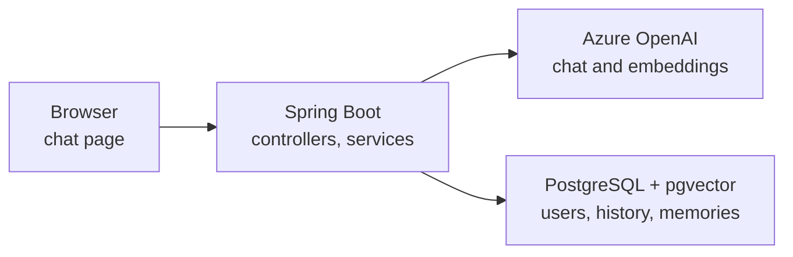

<h1 align="center">JavaChat</h1>

<p align="center">
  <strong>A chat assistant that remembers you</strong>
</p>

<p align="center">
  A single chat window backed by an AI model, where every user gets their own long term memory stored as embeddings in PostgreSQL.
</p>

<p align="center">
  
  
  
  
  
  
  
  
</p>

---

## What is JavaChat?

Language models don't remember anything between requests. Every call starts from nothing, and
chatbots that seem to remember you are really resending context each time.

JavaChat does that part on purpose. You log in with Google, talk to the assistant, and it keeps two
kinds of memory about you. Recent messages are stored as plain rows and sent along with each
request. Facts about you are stored as embeddings in pgvector, and before every reply the app looks
up the ones closest in meaning to what you just said and adds them to the prompt. A question about
your career can find "works as a Java developer" even when the two share no words.

The model decides what is worth remembering through a tool call. The app decides who the memory
belongs to.

## Stack

| | |
|---|---|
| Backend | Java 21, Spring Boot 4.1, Spring Security |
| AI | Spring AI 2.0, Azure OpenAI with `gpt-4.1-mini` for chat and `text-embedding-3-small` for embeddings |
| Data | PostgreSQL 18 with pgvector, Spring Data JPA on Hibernate, Flyway migrations |
| Auth | Google sign in through OAuth2 and OpenID Connect, no passwords stored |
| Hosting | Docker Compose on my own server behind a reverse proxy, with only the model calls going to Azure |

## How it's put together



The app runs next to its database on my server. The only thing that leaves it is the call to the
model, and the Azure deployment uses the EU data zone, so prompts are processed inside the EU.

## Running it locally

You need Java 21 and Docker. Maven is optional because the project includes the Maven wrapper.

Copy `.env.example` to `.env` and fill it in. It's gitignored, and the app reads it on startup.

```
DB_PASSWORD=          any password, the database container is created with it
GOOGLE_CLIENT_ID=     from Google Cloud Console, OAuth client of type Web application
GOOGLE_CLIENT_SECRET=
AZURE_OPENAI_ENDPOINT=  https://<your-resource>.openai.azure.com
AZURE_OPENAI_API_KEY=
```

The Google client needs `http://localhost:8080/login/oauth2/code/google` as a redirect URI.

Start the database, then the app:

```bash
docker compose up -d db
./mvnw spring-boot:run
```

The app is on http://localhost:8080. Flyway creates the tables on the first start.

**Full stack with Docker:** with the same `.env`, run `docker compose --profile app up -d --build`.
The app listens on `127.0.0.1:8080` and is meant to sit behind a reverse proxy.
