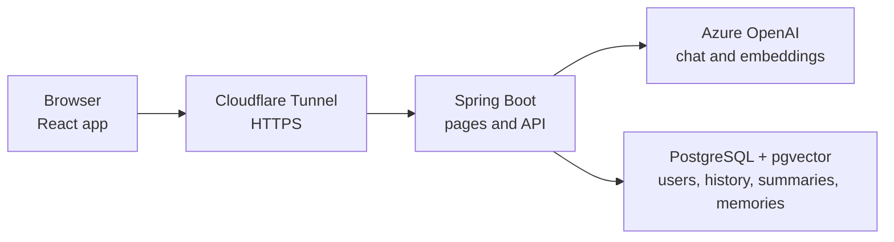

<h1 align="center">JavaChat</h1>

<p align="center">
  <strong>A chat assistant that remembers you</strong>
</p>

<p align="center">
  A single chat window backed by an AI model, where every user gets their own long term memory stored as embeddings in PostgreSQL.
</p>

<p align="center">
  <a href="https://javachat.ignjatradojicic.com"><strong>javachat.ignjatradojicic.com</strong></a>
</p>

<p align="center">
  
  
  
  
  
  
  
  
  
  
</p>

---

## What is JavaChat?

Language models don't remember anything between requests. Every call starts from nothing, and
chatbots that seem to remember you are really resending context each time.

JavaChat does that part on purpose. You log in with Google, talk to the assistant, and it keeps two
kinds of memory about you. Recent messages are stored as plain rows and sent along with each
request. Facts about you are stored as embeddings in pgvector, and before every reply the app looks
up the ones closest in meaning to what you just said and adds them to the prompt. A question about
your career can find "works as a Java developer" even when the two share no words.

The model decides what is worth remembering through a tool call. The app decides who the memory
belongs to.

Replies stream in as they are written and type out at a readable pace. Older parts of a long
conversation are folded into a short running summary, so the assistant keeps the thread without
resending everything. You can see every memory it holds about you, delete any of them, start a
fresh conversation, or delete your account and all its data from the settings panel.

If you want to learn how every part works, from login to streaming replies to deployment, read
[How JavaChat Works](docs/how-it-works.md).

## Stack

| | |
|---|---|
| Backend | Java 21, Spring Boot 4.1, Spring Security |
| AI | Spring AI 2.0, Azure OpenAI with `gpt-4.1-mini` for chat and `text-embedding-3-small` for embeddings |
| Data | PostgreSQL 18 with pgvector, Spring Data JPA on Hibernate, Flyway migrations |
| Auth | Google sign in through OAuth2 and OpenID Connect, no passwords stored |
| Frontend | React 19 and TypeScript built with Vite, served from inside the Spring Boot jar |
| Tests | JUnit, MockMvc and Testcontainers against a real PostgreSQL with pgvector |
| Hosting | Docker Compose on my own Debian server behind a Cloudflare Tunnel, with only the model calls going to Azure |

## How it's put together



The app runs next to its database on my server, and the built React app is served from the same
jar, so the pages and the API share one origin. The only thing that leaves the server is the call to
the model, and the Azure deployments use the EU data zone, so prompts are processed inside the EU.

## Keeping users apart

Every request takes the user from the login session and never from anything the browser sends.
Memories are searched with a filter on the user's ID in SQL, and the tool the model uses to save a
memory gets that ID from the server, so the model cannot choose whose data it touches. Saved memories
and the summary go back into the prompt inside clearly labelled tags as data, never as instructions,
which makes stored prompt injection much harder. Each user can send 10 messages a minute and 200 a
day.

## Running it locally

You need Java 21 and Docker. Maven is optional because the project includes the Maven wrapper.

Copy `.env.example` to `.env` and fill it in. It's gitignored, and the app reads it on startup.

```
DB_PASSWORD=          any password, the database container is created with it
GOOGLE_CLIENT_ID=     from Google Cloud Console, OAuth client of type Web application
GOOGLE_CLIENT_SECRET=
AZURE_OPENAI_ENDPOINT=  https://<your-resource>.openai.azure.com
AZURE_OPENAI_API_KEY=
```

The Google client needs `http://localhost:8080/login/oauth2/code/google` as a redirect URI.

Start the database, then the app:

```bash
docker compose up -d db
./mvnw spring-boot:run
```

The API is on http://localhost:8080. Flyway creates the tables on the first start.

For the interface, run the Vite dev server next to it. It passes API and login requests through to
8080, so add `http://localhost:5173/login/oauth2/code/google` as a redirect URI too.

```bash
cd frontend
npm install
npm run dev
```

Then open http://localhost:5173.

**Tests:** `./mvnw test` runs the backend tests against a real PostgreSQL with pgvector, which
Testcontainers starts in Docker, so Docker has to be running.

**One jar:** `./mvnw package` also builds the frontend and puts it inside the jar, so
`java -jar target/javachat-0.0.1-SNAPSHOT.jar` serves the whole app on port 8080.

**Full stack with Docker:** with the same `.env`, run `docker compose --profile app up -d --build`.
The app listens on `127.0.0.1:8080` and is meant to sit behind a reverse proxy or tunnel.

## Known limits

Sessions and rate limits are kept in memory, so restarting the app signs everyone out and resets
the limits, and it runs as a single instance. Azure retires `gpt-4.1-mini` on 14 April 2027, and
moving to a newer model is a configuration change. Both are explained in the
[guide](docs/how-it-works.md#known-limits).
